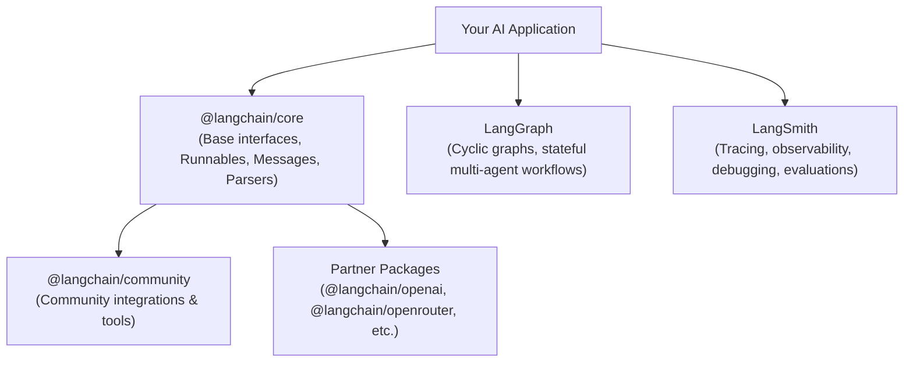

# Chapter 0: What is LangChain?

## 1. Overview

**LangChain** is an open-source orchestration framework designed to simplify the creation of applications powered by Large Language Models (LLMs).

While calling an LLM API directly (e.g., via `fetch` or SDKs) allows basic text generation, building production-ready applications requires much more:
- Composing multiple model calls together.
- Formatting and constraining prompts.
- Parsing unstructured text into structured, typed data.
- Connecting LLMs to external data sources (RAG — Retrieval-Augmented Generation).
- Equipping LLMs with external tools (APIs, calculators, databases) and building autonomous agents.

LangChain provides modular abstractions and a unified interface across different AI providers (OpenAI, Anthropic, Google Gemini, OpenRouter, Ollama, etc.), eliminating vendor lock-in.

---

## 2. The LangChain Ecosystem

The LangChain ecosystem is split into modular packages:



| Package | Purpose |
| :--- | :--- |
| **`@langchain/core`** | Base abstractions: Runnables (LCEL), message types, output parsers, prompt templates. Lightweight with minimal dependencies. |
| **Partner Packages** | Vendor-specific packages (e.g., `@langchain/openai`, `@langchain/openrouter`, `@langchain/google-genai`). |
| **`@langchain/community`** | Community-maintained third-party integrations (vector stores, tools, loaders). |
| **`langchain`** | Main package containing higher-level chains, agents, and retrieval strategies. |
| **`LangGraph`** | Advanced orchestration library for building stateful, multi-actor applications with cycles. |
| **`LangSmith`** | Developer platform for debugging, tracing, testing, and monitoring LLM applications. |

---

## 3. Project Initialization & Setup (Node.js / JavaScript)

### Step 1: Initialize Project
```bash
mkdir langchain-project
cd langchain-project
npm init -y
```

### Step 2: Configure ES Modules
Add `"type": "module"` to `package.json` to enable modern ES syntax (`import`/`export`):

```json
{
  "name": "langchain-project",
  "version": "1.0.0",
  "type": "module",
  "scripts": {
    "start": "node src/index.js"
  }
}
```

### Step 3: Install Core Dependencies
```bash
# Core abstractions and environment variable loader
npm install @langchain/core dotenv zod

# Provider package (e.g., OpenRouter or OpenAI)
npm install @langchain/openrouter
```

### Step 4: Configure Environment Variables
Create a `.env` file in your project root:

```env
OPENROUTER_API_KEY=your_openrouter_api_key_here
```

Create an `env.js` helper:

```javascript
import { config } from "dotenv";
import { fileURLToPath } from "node:url";

config({ path: fileURLToPath(new URL(".env", import.meta.url)) });

const apiKey = process.env.OPENROUTER_API_KEY;

if (!apiKey) {
  throw new Error("Missing OPENROUTER_API_KEY in .env");
}

export const env = Object.freeze({
  apiKey,
  model: "nvidia/nemotron-3-ultra-550b-a55b:free",
});
```

---

## 4. Minimal "Hello World" Example

Create `src/index.js`:

```javascript
import { env } from "../env.js";
import { ChatOpenRouter } from "@langchain/openrouter";

// 1. Initialize the model
const model = new ChatOpenRouter({
  apiKey: env.apiKey,
  model: env.model,
  temperature: 0,
});

// 2. Invoke the model
const response = await model.invoke("Why is LangChain useful for developers?");

// 3. Inspect output
console.log(response.content);
```

---

## 5. Core Concepts at a Glance

1. **Models (ChatModels)**:
   The interface to LLMs. Takes messages as input and returns an `AIMessage`.
2. **Prompts**:
   Template systems (`ChatPromptTemplate`) to create dynamic, reusable prompts with input variables.
3. **Output Parsers**:
   Components that take raw text or AI messages and parse them into structured objects, arrays, or numbers.
4. **LCEL (LangChain Expression Language)**:
   A declarative way to chain components together using `.pipe()`.
5. **Tools & Agents**:
   Allowing models to call functions, query databases, or execute code to solve complex, multi-step tasks.

