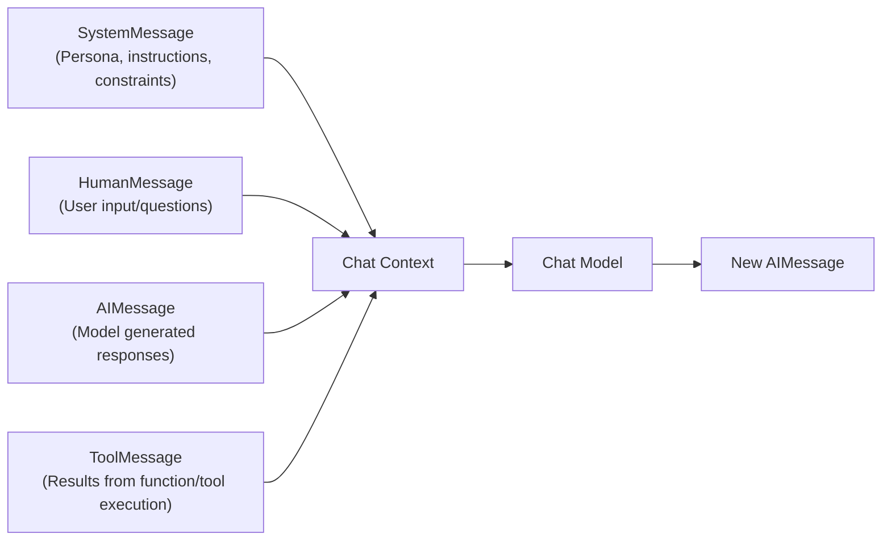

# Chapter 1: ChatModels and MessageTypes

## 1. Understanding Chat Models

In LangChain, there are two historical types of models:
1. **LLMs (Legacy Text Completion)**: Input string $\rightarrow$ Output string (e.g., GPT-3 `davinci`).
2. **Chat Models (Modern Standard)**: Input array of **Messages** $\rightarrow$ Output **AIMessage** (e.g., GPT-4o, Claude 3.5, Nemotron, Llama 3).

Modern applications almost exclusively use **Chat Models**.

---

## 2. Model Configuration & Parameters

When instantiating a Chat Model, common configuration options include:

```javascript
import { ChatOpenRouter } from "@langchain/openrouter";

const model = new ChatOpenRouter({
  apiKey: process.env.OPENROUTER_API_KEY,
  model: "nvidia/nemotron-3-ultra-550b-a55b:free",
  temperature: 0.2,   // 0.0 = deterministic & factual, 1.0+ = creative
  maxTokens: 1024,    // Maximum number of tokens the model can generate
  timeout: 30000,     // Timeout in milliseconds
  maxRetries: 2,      // Number of automatic retries on network/rate-limit error
});
```

---

## 3. Message Types in LangChain

Chat Models operate on conversation sequences. LangChain represents each message role with specific classes from `@langchain/core/messages`:



### The 4 Primary Message Classes:

1. **`SystemMessage`**:
   - Defines the model's persona, tone, rules, and behavioral boundaries.
   - Example:
     ```javascript
     new SystemMessage("You are a strict programming tutor. Never give direct answers, guide with hints.");
     ```

2. **`HumanMessage`**:
   - Represents the user's input, questions, or prompts.
   - Example:
     ```javascript
     new HumanMessage("What is the difference between null and undefined in JavaScript?");
     ```

3. **`AIMessage`**:
   - Represents the response produced by the model.
   - Can also represent past assistant turns when providing multi-turn chat history or few-shot examples.
   - Example:
     ```javascript
     new AIMessage("In JavaScript, undefined means a variable has been declared but not assigned a value...");
     ```

4. **`ToolMessage`**:
   - Represents the result returned by a tool or function that the model invoked.
   - Contains a `tool_call_id` matching the model's requested tool call.

---

## 4. Message Input Styles

LangChain supports three equivalent formats to pass messages to `model.invoke()`:

### Style A: LangChain Message Classes (Recommended)
```javascript
import { SystemMessage, HumanMessage } from "@langchain/core/messages";

const response = await model.invoke([
  new SystemMessage("You are an expert mathematician."),
  new HumanMessage("Calculate 17 * 23."),
]);
```

### Style B: OpenAI-style Role Objects
```javascript
const response = await model.invoke([
  { role: "system", content: "You are an expert mathematician." },
  { role: "user", content: "Calculate 17 * 23." },
]);
```

### Style C: 2-Element Tuples
```javascript
const response = await model.invoke([
  ["system", "You are an expert mathematician."],
  ["human", "Calculate 17 * 23."],
]);
```

---

## 5. Multi-Turn Conversation (Chat History)

LLMs are stateless — they do not remember previous calls. To maintain a conversation, you pass the history of previous messages with each request:

```javascript
import { SystemMessage, HumanMessage, AIMessage } from "@langchain/core/messages";

const chatHistory = [
  new SystemMessage("You are a personal fitness coach."),
  new HumanMessage("My name is Alex and I want to start running."),
  new AIMessage("Hi Alex! Great goal. How many days a week can you train?"),
  new HumanMessage("I can train 3 days a week."),
];

const followUpResponse = await model.invoke(chatHistory);
console.log(followUpResponse.content);
```

---

## 6. Advanced Model Capabilities

### A. Streaming (`model.stream`)
Instead of waiting for the full response, stream tokens in real-time:

```javascript
const stream = await model.stream("Write a poem about asynchronous JavaScript.");

for await (const chunk of stream) {
  process.stdout.write(chunk.content);
}
```

### B. Batching (`model.batch`)
Execute multiple prompts concurrently to minimize total latency:

```javascript
const responses = await model.batch([
  "Summarize Git in one sentence.",
  "Summarize Docker in one sentence.",
  "Summarize Kubernetes in one sentence.",
]);

responses.forEach((res) => console.log(res.content));
```

### C. Inspecting Response Metadata & Token Usage
An `AIMessage` returned by `model.invoke()` includes rich metadata:

```javascript
const response = await model.invoke("Hello!");

console.log("Generated Text:", response.content);
console.log("Finish Reason:", response.response_metadata?.finish_reason);
console.log("Token Usage:", response.usage_metadata);
// Example output: { input_tokens: 12, output_tokens: 25, total_tokens: 37 }
```

