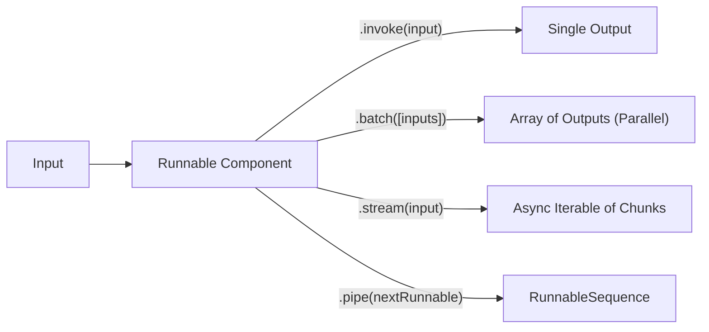
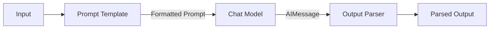
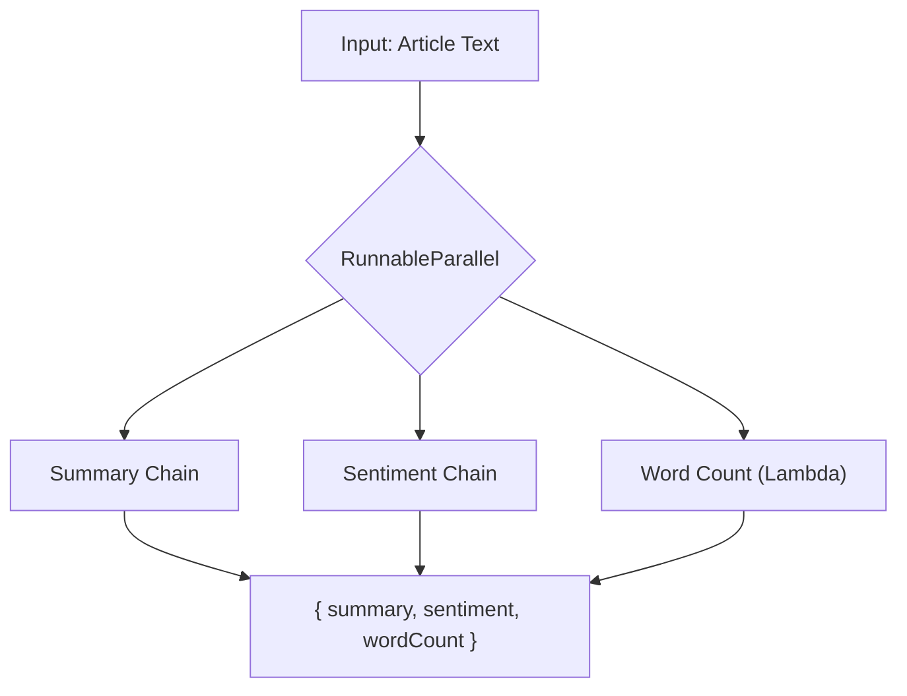

# Chapter 3: Runnables & LangChain Expression Language (LCEL)

## 1. What is a Runnable?

The **Runnable protocol** is the universal interface that powers **LangChain Expression Language (LCEL)**.

In LangChain, almost every core component is a Runnable:
- **Chat Models** (`ChatOpenRouter`, `ChatOpenAI`, etc.)
- **Prompt Templates** (`ChatPromptTemplate`, `PromptTemplate`)
- **Output Parsers** (`StringOutputParser`, `JsonOutputParser`, `StructuredOutputParser`)
- **Retrievers** & **Vector Stores**
- **Tools**

Because they all share the exact same interface, any two Runnables can be composed together into sequential, parallel, or conditional pipelines with zero friction.

---

## 2. The Core Runnable Interface

Every Runnable in LangChain provides the following standardized methods:



| Method | Description |
| :--- | :--- |
| **`.invoke(input, config?)`** | Runs the component on a single input synchronously/asynchronously. |
| **`.batch([inputs], config?)`** | Runs the component over a list of inputs concurrently. |
| **`.stream(input, config?)`** | Streams output chunks as they are generated. |
| **`.pipe(nextRunnable)`** | Chains this Runnable with another sequentially. |
| **`.withFallbacks({ fallbacks })`** | Attaches backup Runnables if the primary one throws an error. |

---

## 3. Key Runnable Classes

All runnable classes are imported from `@langchain/core/runnables`:

```javascript
import {
  RunnableSequence,
  RunnableParallel,
  RunnableLambda,
  RunnablePassthrough,
  RunnableBranch,
} from "@langchain/core/runnables";
```

---

## 4. Detailed Component Guides

### 4.1 `RunnableLambda`: Wrapping Custom Functions
Turn any normal JavaScript function (synchronous or asynchronous) into a Runnable:

```javascript
import { RunnableLambda } from "@langchain/core/runnables";

// Sync or async function
const formatUser = (user) => `${user.firstName} ${user.lastName.toUpperCase()}`;

// Wrap with RunnableLambda
const userRunnable = RunnableLambda.from(formatUser);

// Gains invoke & batch automatically!
const result = await userRunnable.invoke({ firstName: "John", lastName: "Doe" });
// "John DOE"

const batchResult = await userRunnable.batch([
  { firstName: "Ada", lastName: "Lovelace" },
  { firstName: "Alan", lastName: "Turing" },
]);
// ["Ada LOVELACE", "Alan TURING"]
```

---

### 4.2 `RunnableSequence` & `.pipe()`
Linear sequential pipelines where the output of each step is automatically passed as the input to the next step.



```javascript
import { ChatPromptTemplate } from "@langchain/core/prompts";
import { StringOutputParser } from "@langchain/core/output_parsers";

// Using .pipe() syntax
const chain = ChatPromptTemplate.fromMessages([
  ["system", "You are an English to French translator."],
  ["human", "{text}"],
])
  .pipe(model)
  .pipe(new StringOutputParser());

const translation = await chain.invoke({ text: "Hello world" });
// "Bonjour le monde"
```

You can also construct it explicitly:
```javascript
const explicitChain = RunnableSequence.from([prompt, model, parser]);
```

---

### 4.3 `RunnableParallel`: Concurrent Execution
Takes a single input and feeds it to multiple Runnables in parallel. The return value is an object whose keys match the branch names:



```javascript
import { RunnableParallel, RunnableLambda } from "@langchain/core/runnables";

const parallelChain = RunnableParallel.from({
  summary: summaryChain,
  sentiment: sentimentChain,
  wordCount: RunnableLambda.from((text) => text.split(/\s+/).length),
});

const result = await parallelChain.invoke("LangChain simplifies AI development.");
// {
//   summary: "...",
//   sentiment: "POSITIVE",
//   wordCount: 4
// }
```

---

### 4.4 `RunnablePassthrough` & `.assign()`
When building pipelines, you often need to preserve earlier inputs or add intermediate computed values to an object state without discarding existing keys:

```javascript
import { RunnablePassthrough } from "@langchain/core/runnables";

// Adds new properties to the existing input object:
const statePipeline = RunnablePassthrough.assign({
  // Calculate uppercase title
  upperTitle: (input) => input.title.toUpperCase(),
  // Add metadata
  createdAt: () => new Date().toISOString(),
});

const output = await statePipeline.invoke({ title: "Mastering LangChain" });
// {
//   title: "Mastering LangChain",
//   upperTitle: "MASTERING LANGCHAIN",
//   createdAt: "2026-11-23T..."
// }
```

---

### 4.5 `RunnableBranch`: Conditional Routing (If/Else)
Routes an incoming input to different Runnables depending on condition predicate functions:

```javascript
import { RunnableBranch, RunnableLambda } from "@langchain/core/runnables";

const isCodingQuestion = (input) => /code|javascript|python|bug/i.test(input);
const isMathQuestion = (input) => /calculate|math|sum|\+/i.test(input);

const routerChain = RunnableBranch.from([
  [isCodingQuestion, codingSpecialistChain],
  [isMathQuestion, mathSpecialistChain],
  generalAssistantChain, // Default fallback
]);

const response = await routerChain.invoke("How do I fix a null pointer exception in JavaScript?");
```

---

### 4.6 Resilience with `withFallbacks()`
Provide automatic failover to alternative models or services if the primary Runnable fails:

```javascript
const primaryModel = new ChatOpenRouter({ model: "nvidia/nemotron-3-ultra-550b-a55b:free" });
const backupModel = new ChatOpenRouter({ model: "meta-llama/llama-3.3-70b-instruct:free" });

// If primaryModel fails (e.g. rate limit, 500/503 error), backupModel is invoked automatically
const resilientModel = primaryModel.withFallbacks({
  fallbacks: [backupModel],
});
```

---

## 5. Summary Table

| Runnable | Role | Typical Use Case |
| :--- | :--- | :--- |
| **`RunnableLambda`** | Function wrapper | Data transformations, custom validations, formatting. |
| **`RunnableSequence`** | Sequential pipeline | Standard prompt $\rightarrow$ model $\rightarrow$ parser pipelines. |
| **`RunnableParallel`** | Simultaneous branches | RAG (question + retrieved docs in parallel), multi-angle analysis. |
| **`RunnablePassthrough`** | State pass-through & enrich | Adding fields to state objects via `.assign()`. |
| **`RunnableBranch`** | Conditional router | Directing user queries to specialized sub-agents/chains. |
| **`withFallbacks`** | Error recovery | Switching to backup LLM models on rate limits or API downtime. |

