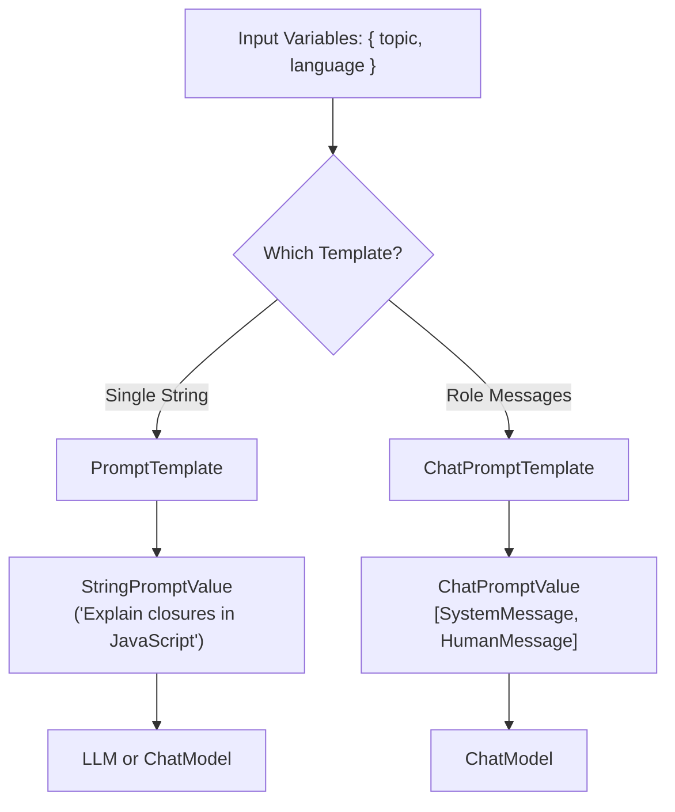
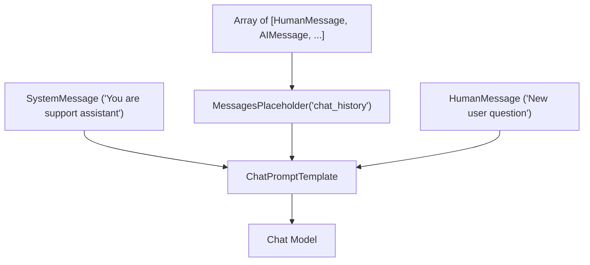

# Chapter 4: PromptTemplate and ChatPromptTemplate

## 1. What are Prompt Templates?

LLMs are driven by natural language prompts. In production applications, hardcoding strings with string interpolation (`${variable}`) quickly becomes brittle, unmaintainable, and hard to compose.

**Prompt Templates** solve this by:
- Defining reusable, parameterized prompt structures with `{placeholders}`.
- Distinguishing between raw string prompts (`PromptTemplate`) and multi-role chat prompts (`ChatPromptTemplate`).
- Dynamically injecting conversation histories (`MessagesPlaceholder`).
- Enabling few-shot examples (`FewShotChatMessagePromptTemplate`).
- Supporting partial variable bindings (`.partial()`).
- Seamlessly integrating into **LCEL pipelines** via `.pipe()`.

---

## 2. Core Differences: `PromptTemplate` vs. `ChatPromptTemplate`



| Feature | `PromptTemplate` | `ChatPromptTemplate` |
| :--- | :--- | :--- |
| **Output Type** | Single string (`StringPromptValue`) | Array of messages (`ChatPromptValue`) |
| **Primary Target** | Text Completion models or single prompts | Modern Chat Models (`ChatOpenRouter`, etc.) |
| **Structure** | Plain text template with `{vars}` | Array of message roles (`system`, `human`, `ai`) |

---

## 3. `PromptTemplate` (String-based)

Used for generating single prompt strings:

```javascript
import { PromptTemplate } from "@langchain/core/prompts";

// 1. Create template
const prompt = PromptTemplate.fromTemplate(
  "Explain {concept} to a {level} programmer."
);

// 2. Format to raw string
const formatted = await prompt.format({
  concept: "recursion",
  level: "beginner",
});
// "Explain recursion to a beginner programmer."

// 3. Pipe directly into a model
const chain = prompt.pipe(model).pipe(new StringOutputParser());
const result = await chain.invoke({ concept: "recursion", level: "beginner" });
```

---

## 4. `ChatPromptTemplate` (Message-based)

Modern chat models expect a list of structured messages with roles.

### Style A: 2-Element Tuples (Recommended & Most Common)
```javascript
import { ChatPromptTemplate } from "@langchain/core/prompts";

const chatPrompt = ChatPromptTemplate.fromMessages([
  [
    "system",
    "You are a helpful software tutor specializing in {language}. Provide concise code snippets.",
  ],
  ["human", "How do I use {concept} in {language}?"],
]);

const chain = chatPrompt.pipe(model).pipe(new StringOutputParser());

const response = await chain.invoke({
  language: "JavaScript",
  concept: "Array.prototype.map()",
});
```

### Style B: Explicit Message Prompt Classes
```javascript
import {
  ChatPromptTemplate,
  SystemMessagePromptTemplate,
  HumanMessagePromptTemplate,
} from "@langchain/core/prompts";

const chatPrompt = ChatPromptTemplate.fromMessages([
  SystemMessagePromptTemplate.fromTemplate("You are an expert in {field}."),
  HumanMessagePromptTemplate.fromTemplate("Explain {question}."),
]);
```

---

## 5. `MessagesPlaceholder` (Dynamic Chat History)

When building conversational chatbots, you need to inject an ongoing list of previous messages into the prompt dynamically without predefining how many messages exist:



```javascript
import { ChatPromptTemplate, MessagesPlaceholder } from "@langchain/core/prompts";
import { HumanMessage, AIMessage } from "@langchain/core/messages";

const promptWithHistory = ChatPromptTemplate.fromMessages([
  ["system", "You are an e-commerce assistant."],
  // Injects an arbitrary array of messages here:
  new MessagesPlaceholder("chat_history"),
  ["human", "{user_input}"],
]);

const chain = promptWithHistory.pipe(model).pipe(new StringOutputParser());

// Previous chat turns:
const pastMessages = [
  new HumanMessage("Where is my order #123?"),
  new AIMessage("Order #123 was shipped yesterday and is out for delivery!"),
];

const reply = await chain.invoke({
  chat_history: pastMessages,
  user_input: "Can I change the delivery address now?",
});
```

---

## 6. Partial Prompt Templates (`.partial()`)

Partial templates allow you to bind a subset of required variables upfront, so callers only need to provide the remaining variables at invocation time.

This is especially helpful for:
1. Static variables (e.g., application name, user subscription tier).
2. Dynamic functions (e.g., `currentDate: () => new Date().toISOString()`).

```javascript
const basePrompt = ChatPromptTemplate.fromMessages([
  [
    "system",
    "Assistant for plan: {plan}. Current timestamp: {timestamp}.",
  ],
  ["human", "{query}"],
]);

// Partially bind `plan` and dynamic `timestamp` function
const enterprisePrompt = await basePrompt.partial({
  plan: "Enterprise",
  timestamp: () => new Date().toISOString(),
});

// Invocation only requires { query }!
const chain = enterprisePrompt.pipe(model);
const result = await chain.invoke({ query: "What is my uptime SLA?" });
```

---

## 7. Few-Shot Prompting (`FewShotChatMessagePromptTemplate`)

Few-shot prompting provides the model with in-context examples of user requests and desired responses to guide style, tone, and output formatting:

```javascript
import {
  ChatPromptTemplate,
  FewShotChatMessagePromptTemplate,
} from "@langchain/core/prompts";

// 1. Examples dataset
const examples = [
  { word: "happy", antonym: "sad" },
  { word: "tall", antonym: "short" },
  { word: "energetic", antonym: "lethargic" },
];

// 2. Template for each individual example
const examplePrompt = ChatPromptTemplate.fromMessages([
  ["human", "{word}"],
  ["ai", "{antonym}"],
]);

// 3. Assemble few-shot prompt
const fewShotPrompt = new FewShotChatMessagePromptTemplate({
  examplePrompt,
  examples,
  inputVariables: [],
});

// 4. Combine into final prompt
const finalPrompt = ChatPromptTemplate.fromMessages([
  ["system", "Respond ONLY with the antonym of the provided word."],
  fewShotPrompt,
  ["human", "{word}"],
]);

const chain = finalPrompt.pipe(model).pipe(new StringOutputParser());
const result = await chain.invoke({ word: "benevolent" }); // "malevolent"
```

---

## 8. Summary Table

| Class / Concept | Role | Primary Usage |
| :--- | :--- | :--- |
| **`PromptTemplate`** | String template | Text completion models or single string pipelines. |
| **`ChatPromptTemplate`** | Multi-role chat template | Modern Chat Models with `system`, `human`, and `ai` roles. |
| **`MessagesPlaceholder`** | Dynamic message slot | Injecting conversation history (`chat_history`) or tool outputs. |
| **`.partial()`** | Pre-bind variables | Fixing variables or binding dynamic generators (timestamps, configs). |
| **`FewShotChatMessagePromptTemplate`** | In-context learning | Providing multi-turn example pairs to steer model behavior. |
| **`.format()` vs `.invoke()`** | Formatting helper | `.format()` returns string; `.invoke()` returns `PromptValue` for LCEL. |

